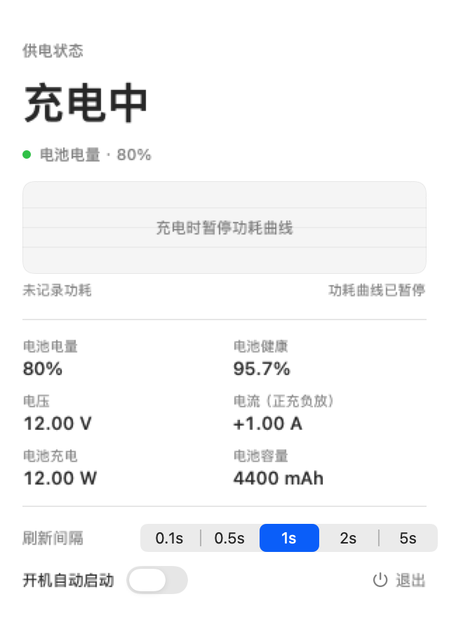

# Mac功率计 · Mac-PowerMeter

一个轻量的 macOS 菜单栏功率计。使用系统框架读取电池和系统功率遥测，无需管理员权限，不依赖第三方运行库。

- 电池供电时显示紧凑的功率数字，例如 `6.8W`。
- 充电时显示“充电中”，暂停功耗曲线。
- 弹窗展示电量、健康度、电压、电流、适配器输入或电池功率，以及最近约 60 秒的趋势。
- 默认每秒读取一次，可选择 0.1、0.5、1、2、5 秒。
- 支持用户开机启动，仅读取电池与 SMC 遥测，不修改充电限制。

## 环境要求

- Apple Silicon Mac；当前构建目标为 arm64。
- macOS 14 或以上。
- 构建需要 Xcode Command Line Tools 或完整 Xcode，以及可用的 macOS SDK。
- 普通应用构建不需要 Python；重新生成图标时需要 Python 3 与 Pillow。

当前版本已在 Apple M2、macOS 27 上验证电池供电与充电状态。其他机型的 SMC key、格式及刷新速度可能不同。

## 构建与安装

首次使用开发工具时，可以运行 `xcode-select --install` 安装 Command Line Tools。

在仓库根目录执行：

```bash
bash build.sh
open build/PowerMeter.app
```

产物位于 `build/PowerMeter.app`。默认构建不修改已安装应用。

安装到应用目录：

```bash
bash build.sh --install
open /Applications/PowerMeter.app
```

更新前请退出正在运行的旧版。安装脚本会将原版压缩备份到 `build/PowerMeter-previous.zip`，应用目录只保留一个 `PowerMeter.app`。应用使用 ad-hoc 签名，未经过 Developer ID 公证。

开机启动通过用户 `LaunchAgent` 实现。请从准备长期保留的位置打开应用后启用；移动应用后，关闭再开启此开关以更新路径。

## 功率计算

| 状态 | 主读数 |
|---|---|
| 电池供电，SMC 可用 | `abs(B0AC × B0AV) / 1,000,000`：电流 mA × 电压 mV → W |
| 电池供电，SMC 不可用 | 优先 `SystemLoad / 1000`，其次电池功率或电压×电流估算 |
| 接外部电源、未充电 | `SystemLoad / 1000`；缺失时显示 `--` |
| 充电中 | 显示“充电中”，电池和适配器明细仍可查看 |

SMC 电池侧功率是整机耗电的估算，不等于插座功率或 CPU/GPU 单独功率。适配器输入包含充电和损耗，不能直接当作系统负载。

程序不将 SMC 与系统遥测通过滑动均值叠加。刷新频率与传感器更新速度是两回事：0.1 秒读取不保证 0.1 秒产生新数据。“未变化”表示数值没有变化，并不表示传感器发生故障。

## 界面预览

下图为固定演示数据，不是实时测量：



## 自检

```bash
build/PowerMeter.app/Contents/MacOS/PowerMeter --selftest
build/PowerMeter.app/Contents/MacOS/PowerMeter --dump
build/PowerMeter.app/Contents/MacOS/PowerMeter --watch 30 1
build/PowerMeter.app/Contents/MacOS/PowerMeter --bench
build/PowerMeter.app/Contents/MacOS/PowerMeter --uitest
build/PowerMeter.app/Contents/MacOS/PowerMeter --uitest --dark
build/PowerMeter.app/Contents/MacOS/PowerMeter --uitest --charging
build/PowerMeter.app/Contents/MacOS/PowerMeter --uitest --unavailable
build/PowerMeter.app/Contents/MacOS/PowerMeter --popovertest
```

- `--selftest`：25 项纯数据回归检查，覆盖充放电、字段缺失、补码电流、容量单位、零值和 SMC 解码，失败返回非零退出码。
- `--dump`：对比 IOKit 和 ioreg 的同一 SystemLoad 字段。两次读取跨过系统更新时刻时，差异不一定意味着故障。
- `--bench`：测量读取墙钟耗时，不代表进程 CPU 使用率。
- `--uitest`：输出 PNG 到系统临时目录。`--charging` 和 `--unavailable` 使用固定样例；预览历史可能使用模拟数据。
- `--popovertest`：短暂显示真实弹窗，检查内容尺寸。

## 文件结构

```text
main.swift             数据解析、监控、菜单栏、自启与命令行入口
SMC.swift              SMC 只读通信与数据解码
Views.swift            SwiftUI 面板与曲线
Regression.swift       纯数据回归检查
build.sh               构建、签名、可选安装
Info.plist             应用元数据
make_icon.py           生成普通应用图标
make_native_icon.py    生成原生分层图标源文件
AppIcon.icon/          Icon Composer 原生源文件
AppIcon_1024.png        安装版使用的图标资源
```

架构说明见 [docs/ARCHITECTURE.md](docs/ARCHITECTURE.md)。

## 原生分层图标

`AppIcon.icon` 包含仪表底层、功率弧、指针及单位三个图层。源文件已通过 Apple 官方 Icon Composer 1.2 的浅色、深色 macOS 渲染验证。

当前脚本构建仍使用 `.icns`。正式启用原生分层图标，需要完整 Xcode 的资源编译工具将 `.icon` 编译为应用资源；仅把 `.icon` 复制进应用并修改图标名称不会生效。macOS 27 可能为传统 `.icns` 自动添加系统底板。

使用 `python3 make_native_icon.py` 可重新生成源文件，用 [Apple Icon Composer](https://developer.apple.com/icon-composer/) 打开 `AppIcon.icon` 编辑。

## 已知限制

- SMC 协议与 key 并非公开稳定接口；支持情况由硬件及系统版本决定。
- 电池遥测可能更新较慢，充满后接电时的系统负载也不保证每秒更新。
- 尚未提供 Intel Mac 构建或跨机型准确度标定。
- 原生分层图标尚未接入当前脚本构建。
